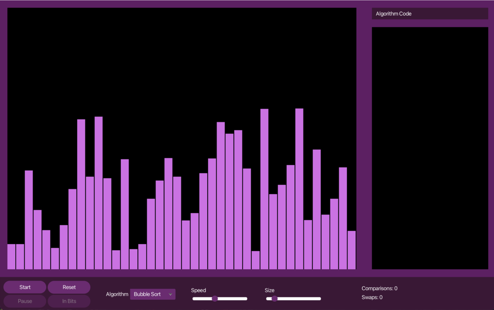

# AlgoView

**An interactive sorting algorithm visualizer developed using Java and JavaFX.**
AlgoView was developed as part of my bachelor's thesis in Computer Science at Roskilde University in Spring 2026.

The project explores how interactive visual representations can support the understanding of sorting algorithms, particularly for students who find abstract algorithmic processes difficult to conceptualize.

## Motivation
Throughout my Computer Science education, I often found it challenging to mentally visualize how algorithms operate, with YouTube animations providing little to no help.

This inspired me to explore whether interactive visualizations could make these concepts more accessible to students facing similar difficulties.

Rather than simply displaying the result of a sorting algorithm, AlgoView allows users to observe how the algorithm progresses, how elements are compared and rearranged, and how different sorting approaches behave.

## Features
AlgoView provides modular interactive visualizations of three sorting algorithms:

- **Bubble Sort** — Demonstrates comparisons and swaps between adjacent elements.
- **Merge Sort** — Visualizes the divide-and-conquer sorting process.
- **Quick Sort** — Demonstrates partitioning and recursive sorting.

The application also includes:

- Animated bar-chart representations of arrays.
- Playback controls for pausing, resuming, and stepping through execution.
- Adjustable visualization speed.
- Array generation and reset functionality.
- Algorithm-specific code displayed alongside the visualization.
- Visual highlighting of algorithmic operations.
- Statistics tracking during execution.

## Technologies
- **Java** — Application logic and sorting algorithm implementations.
- **JavaFX** — Graphical user interface and animations.
- **CSS** — Interface styling.
- **Maven** — Project configuration and dependency management.
- **Figma** — Interface wireframing and design exploration.

## Research and Evaluation
AlgoView was developed alongside my bachelor's thesis, *Learning Through Algorithm Visualization*.

The research investigated whether visual representations and interface design choices could support the understanding of sorting algorithms in an educational context.

The prototype was evaluated through semi-structured interviews with ten participants:
- Five participants with a Computer Science background.
- Five participants without prior Computer Science experience.

### Key Findings
The research suggested that interactive visualizations can support users' general understanding of sorting behaviour, particularly among beginners.

However, more complex algorithms such as Merge Sort and Quick Sort remained challenging for inexperienced users to fully understand without additional explanations.

The findings highlight that visualization can be a valuable supplement to traditional teaching methods, but that effective interface design, contextual guidance, and user interaction remain essential.

## Project Background
Developed during the sixth semester of my BSc in Computer Science at Roskilde University (Spring 2026).

AlgoView combines my interests in software development, algorithms, human-computer interaction, and educational technology.

The project reinforced my interest in making abstract Computer Science concepts more accessible through interactive software.